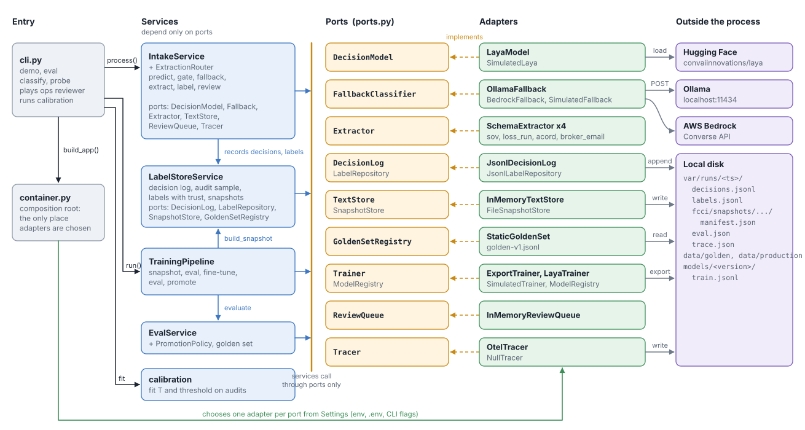
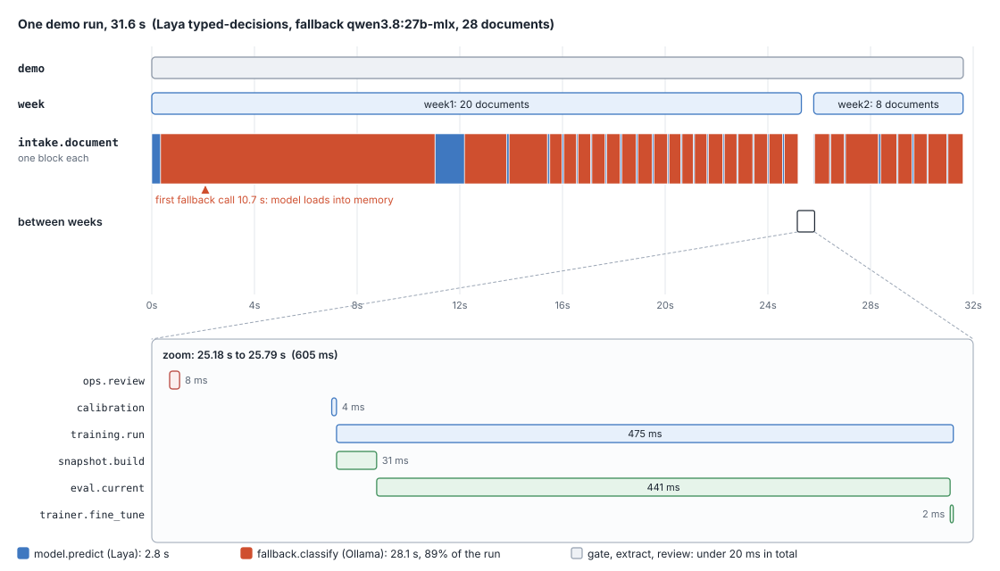
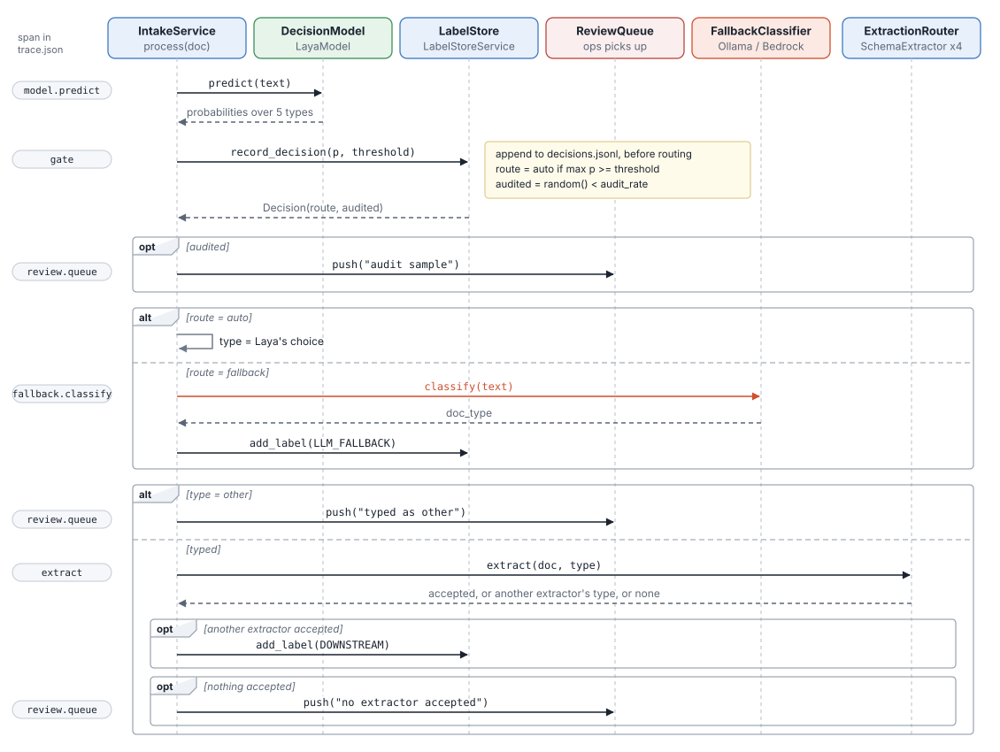
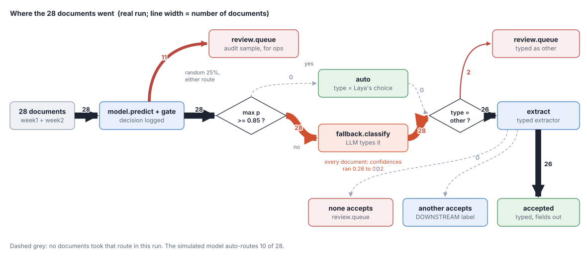
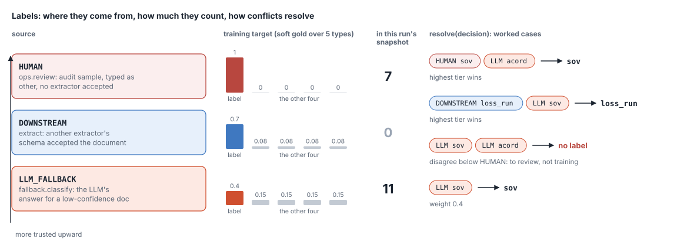
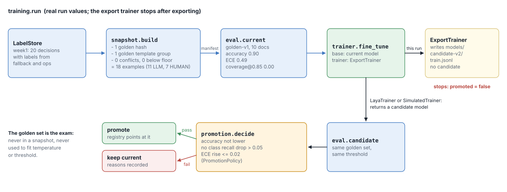

# Components, flows and sequences

How a run moves through the code, which component does what, and how each step shows up in
`var/runs/<ts>/trace.json`. Span names in `code font` are the names you will see in the trace.

Observed figures come from a real run on 25 October 2026: Laya `typed-decisions`, fallback
`ollama:qwen3.8:27b-mlx`, export trainer, 28 production documents (`var/runs/20261025-200303`).

## Summary

Broker submissions arrive as a pile of documents. Before anything can be extracted, each one has to
be typed: schedule of values, loss run, ACORD form, broker email, or something else. Laya, a small
fast decision model, scores every document against the five types in one pass. If it is confident
enough, its answer is used directly; if not, an LLM types the document instead. A typed extractor
then pulls the fields out, and its accept or reject doubles as a check on the type.

Every step leaves a record. Laya's answers go to the decision log; every opinion about a document's
true type (the LLM's, an extractor's, a human reviewer's) goes to the label store with a trust tier.
Those labels become training snapshots that teach Laya the tenant's documents, so over time more
documents clear the gate and fewer need the LLM. A frozen golden set marks the exam every new model
must pass before it replaces the old one, and a random audit sample keeps the confidence gate honest.

## Glossary

### Inputs

| Term | What it is | Why it exists |
|---|---|---|
| Document | The text Laya sees: the first page, the sheet headers or the email body, with a tenant and a template group | Classifying a short, consistent cut keeps Laya fast and inside its context window |
| Document type | One of `sov`, `loss_run`, `acord`, `broker_email`, `other`, each with a description in `CRITERIA` (`domain.py`) | Laya scores the descriptions, so their wording matters; `other` is the safe answer that always goes to a person |
| Tenant | The customer a document belongs to (`fcci` in the demo) | Decisions, labels and snapshots are kept per tenant so one customer's data never trains another's model |
| Template group | A key for the broker or form a document came from, such as `harbourline-sov` or `acord-125` | Documents from the same template look alike; grouping them stops near-duplicates of golden documents leaking into training |
| Document hash | SHA-256 of the normalised text | Spots exact duplicates and golden documents, whatever their id |
| Production samples | `data/production/week1.jsonl` and `week2.jsonl`, each row with `text`, `template_group` and the true type in `truth` | Stand-ins for live traffic; `truth` drives the simulated ops reviewer. Week 1 has 20 hand-written rows and 120 from `scripts/generate_production.py` |

### Deciding and routing

| Term | What it is | Why it exists |
|---|---|---|
| Laya (decision model) | An open-weight, non-autoregressive model that returns a probability for each type in one forward pass | Cheap and fast enough to run on every document; the LLM is the expensive exception |
| Confidence | Laya's highest probability for a document (`answer_confidence`) | The single number the gate compares with the threshold |
| Gate and threshold | The rule "auto if confidence is at least the threshold" (0.85 until calibration changes it) | Trades speed and cost (auto) against safety (fallback) |
| Decision | One logged Laya call: probabilities, model version, threshold, route, audit flag, in `decisions.jsonl` | Written before routing, so every call is on record even if later steps fail; the source of training rows |
| Route | `auto` (use Laya's type) or `fallback` (ask the LLM) | Records which path a document took, for metrics and audit |
| Fallback classifier | An LLM (Ollama `qwen3.8:27b-mlx` locally, Bedrock in production) that types low-confidence documents | Keeps quality up while Laya is unsure, and its answers become training labels |
| Extractor | A typed schema extractor; it accepts a document only if the required fields are present | Gets the data out, and a rejection is evidence the type was wrong |
| Extraction router | Runs the extractor for the chosen type, then the others if it rejects | Recovers the real type when the cover title misleads (a DOWNSTREAM label) |
| Review queue | Decisions waiting for a person: audit samples, documents typed `other`, documents no extractor accepted | Puts humans only where the system is unsure or needs measuring |
| Ops reviewer | The person who works the review queue; simulated in the demo from `truth` | Produces HUMAN labels, the most trusted kind |
| Audit sample | A random 25% of decisions on either route sent for human review whatever happened | An unbiased measure of how accurate Laya really is at each confidence; calibration fits only on it |

### Labels

| Term | What it is | Why it exists |
|---|---|---|
| Label | A claim about a decision's true type, with source, actor, time and note, in `labels.jsonl` | The raw material for training; one decision can collect several |
| Label source (trust tier) | `HUMAN` > `DOWNSTREAM` > `LLM_FALLBACK` | Not all evidence is equal; a person outranks an extractor, which outranks an LLM |
| Resolution | Picking one label per decision: highest tier wins, latest within a tier; disagreement below HUMAN gives no label | Conflicting machine labels go to review instead of teaching the model a guess |
| Soft target | How a label becomes a training row: weight 1.0, 0.7 or 0.4 on the label, the rest spread over the other four types | Laya's training format has no per-row weight, so trust is encoded in the target itself |

### Training, evaluation and release

| Term | What it is | Why it exists |
|---|---|---|
| Golden set | A frozen, versioned set of labelled documents (`golden-v1`, 10 examples) | The exam: never trained on, never used to fit calibration, so model comparisons stay fair |
| Snapshot | A versioned set of training examples with a manifest, built from resolved labels | Reproducible training data; records how many rows were excluded and why |
| Exclusions | Rows a snapshot drops: golden hashes, golden template groups, duplicates, conflicts, labels below the minimum source | Keeps the exam out of the textbook and conflicting labels out of training |
| Trainer | `ExportTrainer` (writes `train.jsonl` only), `LayaTrainer` (real fine-tune), `SimulatedTrainer` (offline stand-in) | Separates producing training data from running an expensive fine-tune |
| Candidate | The model a fine-tune produces | It has to pass the promotion gate before it serves traffic |
| Promotion policy | Accuracy no lower, no class recall drop over 0.05, ECE rise no more than 0.02 | A new model must be at least as good, per class, before it replaces the current one |
| Model registry | Records every candidate with its eval report and snapshot, and which version is current | Rollback and lineage: which data made which model |
| Calibration | Fitting a temperature and a threshold on the audit sample, once there are at least 30 audited decisions | Laya's raw confidences do not match its accuracy; calibration makes the gate mean what it says |
| Temperature | A scale applied to Laya's probabilities: below 1 sharpens them, above 1 flattens them | Fixes over- or under-confidence without changing which type ranks first |
| ECE | Expected calibration error: the average gap between confidence and accuracy | Measures whether confidence can be trusted at all |
| Coverage | The share of documents that clear the threshold | How much traffic avoids the LLM |
| Auto error | The error rate among documents that cleared the threshold | The cost of that coverage; threshold tuning keeps it under 5% |

### Observability

| Term | What it is | Why it exists |
|---|---|---|
| Run directory | `var/runs/<timestamp>/` holding the decision log, labels, snapshots, `eval.json` and `trace.json` | Everything one run did, in one place |
| Trace | `trace.json`: one OpenTelemetry trace per run, a tree of spans in time order | Shows the sequence of steps, what each used and decided, and how long it took |
| Span | One timed step in the trace, such as `gate` or `fallback.classify`, with attributes and events | The unit you read when following a document or finding where time went |
| Simulated adapters | Offline stand-ins for Laya, the LLM and the trainer | Let the whole loop run and be tested with no model downloads |

## 1. Components



*The CLI calls services; services see only ports; `container.py` picks one adapter per port from `Settings`. Adapters are the only code that touches Hugging Face, Ollama, Bedrock or disk.*

| Component | File | Responsibility |
|---|---|---|
| CLI | `cli.py` | Parses flags, runs `demo` and `eval`, plays the simulated ops reviewer, runs calibration |
| Composition root | `container.py` | The only place adapters are chosen, from `Settings` (env, `.env`, CLI flags) |
| IntakeService | `services/intake.py` | One document: predict, gate, audit, fallback, extract, label, review |
| ExtractionRouter | `services/intake.py` | Runs the extractor for the chosen type; if it rejects, tries the others to find the real type |
| LabelStoreService | `services/label_store.py` | Decision log, audit sampling, labels with provenance, label resolution, training snapshots |
| TrainingPipeline | `services/training.py` | Snapshot, eval current, fine-tune, eval candidate, promote |
| EvalService, PromotionPolicy | `services/evaluation.py` | Golden-set metrics and the promotion gate |
| calibration | `services/calibration.py` | Temperature and threshold fitted on the audit sample |
| LayaModel | `adapters/laya_model.py` | `laya.load(...)`, `agent.predict(text, questions)`, answer to a distribution over `DOC_TYPES` |
| OllamaFallback, BedrockFallback | `adapters/fallback.py` | LLM classification with a JSON schema; unparseable output becomes `other` |
| SchemaExtractor | `adapters/extractors.py` | Regex stand-ins; `ok=False` means "not my type" |
| Storage | `adapters/storage.py` | JSONL decision log and labels, file snapshot manifests, in-memory text store and queues |
| Trainers | `adapters/laya_trainer.py`, `adapters/simulated.py` | Export `train.jsonl`, real `laya.train.finetune`, or the offline stand-in |
| OtelTracer | `adapters/tracing.py` | OpenTelemetry spans, written as one nested `trace.json` when the run closes |

## 2. A demo run

`doctype demo` is one trace. `build_app` first chooses the adapters and opens the tracer; then the
root span `demo` opens and these steps nest under it, in order:

1. `week` (week1, 20 documents): `IntakeService.process` per document, then `ops.review` labels everything queued.
2. `calibration`: fits temperature and threshold if there are at least 30 audited decisions, otherwise keeps 0.85.
3. `training.run`: snapshot, eval, fine-tune, and promotion when there is a candidate. Writes `eval.json`.
4. `week` (week2, 8 documents) at the threshold calibration left, then `ops.review` again.

When `demo` closes, even after an exception, the tracer writes `trace.json`.



*Measured from `trace.json`. Each block in the `intake.document` row is one document: blue is Laya, orange is the Ollama fallback. Calibration and the training run sit in the 0.6 s gap between the weeks, shown zoomed below.*

## 3. One document through intake

Every document is an `intake.document` span. Its children appear in this order.



*Left gutter: the span each call appears under in `trace.json`. The decision is logged before any routing, so the decision log has every Laya call even if a later step fails.*

### Routes a document can take



*Line width is the number of documents. Nothing cleared the 0.85 gate, so all 28 went to the fallback; 11 were also picked for audit.*

Step sequences seen in the traces, children of `intake.document` in order:

| Sequence | Real run (28) | Simulated run (28) | Meaning |
|---|---|---|---|
| `model.predict > gate > fallback.classify > extract` | 16 | 10 | Below threshold, LLM typed it, extractor accepted |
| `model.predict > gate > review.queue > fallback.classify > extract` | 10 | 5 | Same, and picked for audit |
| `model.predict > gate > review.queue > fallback.classify > review.queue` | 1 | 2 | Audited, LLM said `other`, so queued twice |
| `model.predict > gate > fallback.classify > review.queue` | 1 | 1 | LLM said `other` |
| `model.predict > gate > extract` | 0 | 6 | Auto-routed |
| `model.predict > gate > review.queue > extract` | 0 | 4 | Auto-routed and audited |

The recovery and "no extractor accepted" branches did not occur in either run; the test
`test_schema_failure_produces_downstream_label` covers recovery.

## 4. Labels and how they are trusted



*The tier sets both how conflicts resolve and how hard a label pushes in training: a HUMAN label is one-hot, an LLM label puts 0.4 on its type and spreads 0.6 over the other four.*

The ops reviewer is simulated: it labels every queued item with `truth` from
`data/production/*.jsonl`. The HUMAN labels on audited decisions are what calibration fits on.

## 5. Training run



*Values are from the real run. With `ExportTrainer` the run stops after writing `train.jsonl`; a real or simulated trainer continues to the candidate eval and the promotion gate.*

The real run used `ExportTrainer`, so the trace stops at `trainer.fine_tune` with
`candidate: "none (exported data only)"`. The simulated run continues to `eval.candidate` and
`promotion.decide` and promoted `candidate-v2`.

## 6. Span reference

| Span | Emitted by | Key attributes | Events |
|---|---|---|---|
| `demo` | `cli.cmd_demo` | `model`, `fallback`, `trainer`, `tenant`, `run_dir` | |
| `eval` | `cli.cmd_eval` | `model_version`, `threshold`, `accuracy`, `ece`, `coverage`, `recall.*` | |
| `week` | `cli._run_week` | `week`, `model_version`, `threshold`, `documents`, `auto_routed` | |
| `intake.document` | `IntakeService.process` | `doc_id`, `tenant_id`, `template_group`, `decision_id`, `final_type`, `path` | |
| `model.predict` | `IntakeService` | `model_version`, `probabilities.*` | |
| `gate` | `IntakeService` | `threshold`, `decision_id`, `doc_hash`, `predicted`, `confidence`, `route`, `audited` | |
| `review.queue` | `IntakeService._push_review` | `decision_id`, `reason` | |
| `fallback.classify` | `IntakeService` | `actor`, `doc_type`, `agrees_with_model` | `label` (LLM_FALLBACK) |
| `extract` | `IntakeService` | `doc_type`, `ok`, `error`, `recovered_type` | `label` (DOWNSTREAM) |
| `ops.review` | `cli._run_week` | `actor`, `items` | `label` per item (HUMAN, reason, doc_type) |
| `calibration` | `cli._demo_steps` | `min_audit_sample`, `audited`, `fitted`, `temperature`, `threshold` | |
| `training.run` | `TrainingPipeline.run` | `tenant_id`, `new_version`, `threshold`, `min_source`, `promoted`, `reasons` | |
| `snapshot.build` | `TrainingPipeline` | `uri`, `snapshot_id`, `examples`, `excluded.*` | |
| `eval.current`, `eval.candidate` | `TrainingPipeline._evaluate` | `model_version`, `golden_version`, `n`, `accuracy`, `ece`, `coverage`, `auto_error`, `recall.*` | |
| `trainer.fine_tune` | `TrainingPipeline` | `base`, `trainer`, `candidate` | |
| `promotion.decide` | `TrainingPipeline` | `current`, `candidate`, `promoted`, `reasons` | |

Every node also carries `trace_id`, `span_id`, `start` (UTC ISO), `duration_ms` and `children`.
A step that raised has `"status": "ERROR"` and an `exception` event with the message.
Document text is never recorded.

## 7. Where the time goes (real run)

| Span | Count | Total ms | Median ms | Max ms |
|---|---|---|---|---|
| `fallback.classify` | 28 | 28,134 | 540 | 10,691 |
| `model.predict` | 28 | 2,829 | 49 | 1,143 |
| `eval.current` | 1 | 441 | 441 | 441 |
| `snapshot.build` | 1 | 31 | 31 | 31 |
| `gate` | 28 | 15 | 0.4 | 4 |
| `extract` | 26 | 1 | 0.0 | 0 |

The whole run took 31.6 s and the fallback took 28.1 s of it (89%). The first call, about
10.7 s, includes loading the 27B model into memory. Each Laya call is about 50 ms once warm.
Because nothing cleared the 0.85 gate, every document paid for the fallback.

## 8. Reading a trace

```bash
# the run's top-level steps
jq -r '.[0].children[].name' var/runs/<ts>/trace.json

# one line per document: id, Laya's choice and confidence, route, final type
jq -r '.. | objects | select(.name? == "intake.document")
       | [.attributes.doc_id, (.children[] | select(.name == "gate") | .attributes.predicted,
          .attributes.confidence, .attributes.route), .attributes.final_type] | @tsv' var/runs/<ts>/trace.json

# any step that failed
jq '.. | objects | select(.status? == "ERROR") | {name, events}' var/runs/<ts>/trace.json
```

Spans are held in memory and written when the run closes, including when it raises. A run killed
outright (for example `kill -9`) leaves no trace file.
